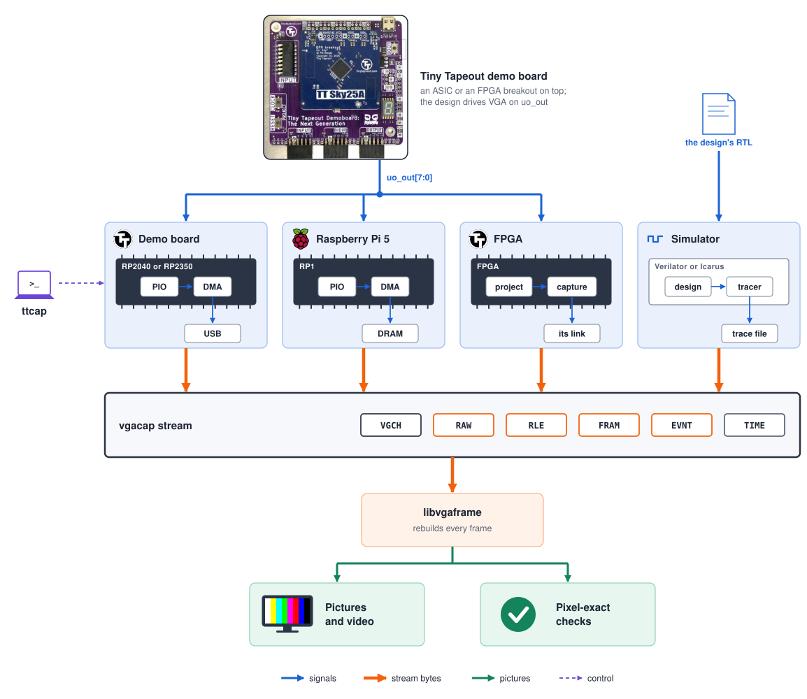

# vgacap

vgacap captures the VGA output of a [Tiny Tapeout](https://tinytapeout.com) design, turns it into pictures and video, and checks it pixel by pixel. This page says what it captures, from where, and what it makes of a capture; the rest of the documentation is linked at its end.

<picture>
  <source media="(prefers-color-scheme: dark)" srcset="docs/diagrams/overview-dark.svg">
  
</picture>

## What it captures

A design that drives the [Tiny VGA Pmod](https://github.com/mole99/tiny-vga) puts its VGA signals on its eight `uo_out` pins. vgacap records those pins once a clock and rebuilds the screen from them. It needs no VGA monitor or video capture card: the pins themselves are the record.

## Where a capture comes from

A capture comes from the demo board's own microcontroller, an RP2040 or RP2350, under the stock firmware, the vgacap firmware or the vgacap MicroPython module. On a demo board with an FPGA breakout, capture logic can also sit beside the design in the FPGA. A Raspberry Pi 5 wired to the board captures with its RP1, and a simulator records a design's RTL without any hardware. Each source's speed and how far it is proven are on [Capture sources compared](docs/reference-capture-sources.md).

## One stream, then pictures

Every source writes the same format, the [vgacap stream](src/stream/explanation-stream.md). So one library, libvgaframe, rebuilds the frames from any capture, and the same tools turn them into PPM pictures, video, waveforms and pixel-exact checks against a calibration design's reference render.

> **Caution: AI in use.** This project is being built with [Claude Code](https://claude.com/claude-code).
> Check the code and the measurements before relying on them.

## The documentation

- [Capturing](docs/capturing/index.md): capturing a design's VGA output, and turning it into pictures and video.
- [Reference](docs/reference/index.md): the formats, the firmware protocol, command options and other facts to look up.
- [Developing vgacap](docs/developing/index.md): building, testing and changing vgacap and these pages.

The design, research notes, measurements and work log are in [mithro/tt-vga-capture](https://github.com/mithro/tt-vga-capture); the calibration designs and their reference renders are in [mithro/tt-vga-testpatterns](https://github.com/mithro/tt-vga-testpatterns). vgacap is Apache-2.0 licensed: see [LICENSE](LICENSE).
