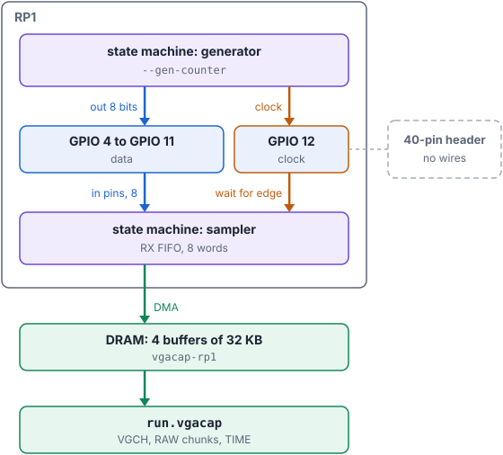

# How to check vgacap-rp1 with the loopback fixture

**You want to see `vgacap-rp1` capture every sample on your Raspberry Pi 5, with nothing wired to its header.**

In the loopback fixture, one RP1 PIO state machine drives a descending count onto the GPIOs that the capture samples. This is the setup the tool was proven on. Wiring a Tiny Tapeout board to a Pi 5 is not covered ([#27](https://github.com/mithro/vgacap/issues/27)).

<picture>
  <source media="(prefers-color-scheme: dark)" srcset="loopback-dark.svg">
  
</picture>

## What you need

- One Raspberry Pi 5, with nothing fitted to its 40-pin header: the fixture drives GPIO 4 to GPIO 12 as outputs.
- `vgacap-rp1` built on that Pi, as in [How to build vgacap-rp1](how-to-build.md).
- Python 3 on the Pi, for the check script [`check_counter.py`](check_counter.py).
- A shell on the Pi, in the top directory of the vgacap checkout, with `sudo` for step 3.

## Steps

1. On the Pi, run `./capture-rp1/vgacap-rp1 --out counter.vgacap --samples 4194304 --gen-counter --gen-div 50 --clock-hz 500000`, which writes `counter.vgacap` and prints one line.
2. On the Pi, run `python3 capture-rp1/check_counter.py counter.vgacap`, which checks that every sample is one less than the sample before it.
3. On the Pi, run `for n in 4 5 6 7 8 9 10 11 12; do sudo pinctrl set $n no; done`, which takes GPIO 4 to GPIO 12 back from the PIO ([#54](https://github.com/mithro/vgacap/issues/54)).

## Check

Step 1 prints a line ending in `dropped=0`, with the measured rate in `samples_per_s`. That rate reads about 500000, the rate declared with `--clock-hz`. On a Pi 5 it printed this ([the bench run](https://github.com/mithro/tt-vga-capture/tree/main/docs/results/2026-11-27-docs-bench-rp1-loopback)):

```text
rp1 samples=4194304 seconds=8.460 samples_per_s=495791 dropped=0
```

Step 2 prints this, and exits with status 0:

```text
ok: 4194304 samples, every step -1
```

The count is 8 bits wide, so a loss of a whole multiple of 256 samples leaves it unbroken. Step 2 cannot see such a loss.

After step 3, `pinctrl get 4-12` shows each of GPIO 4 to GPIO 12 with the function `no`: the PIO no longer drives them.

## If it fails

| What you see | Likely cause | Fix |
|---|---|---|
| `Failed to open PIO device 0` at step 1 | The machine is not a Raspberry Pi 5 or has no `rp1-pio` driver | Run on a Pi 5 with a kernel that provides `/dev/pio0` |
| `--clock-hz … is above 500000` at step 1 | The declared rate is above the rate proven without loss | Declare 500000 or less, as in step 1 |
| `receive DMA failed` at step 1 | A DMA transfer left waiting has wedged the `rp1-pio` driver | Reboot the Pi |
| Every run fails after an interrupted one | A DMA transfer left waiting has wedged the `rp1-pio` driver | Reboot the Pi |
| `samples_per_s` far from 500000 at step 1 | The generator runs at another rate than the one declared | Note the rate, and declare it with `--clock-hz` if it is 500000 or less |
| `broken at sample …` at step 2 | Samples were lost or repeated | Remove anything fitted to the header and repeat step 1 |

## Next

- [vgacap-rp1 options](reference-options.md)
- [RP1 PIO and GPIO facts for vgacap-rp1](reference-rp1-pio.md)
- [Capture on the Raspberry Pi 5's RP1](explanation-capture.md)
