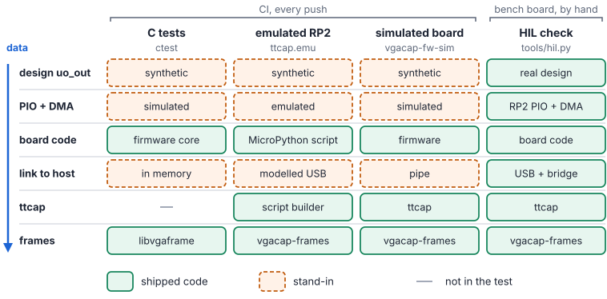

# The test layers of vgacap

This page explains how vgacap is tested. For each kind of test, it says which parts of the capture path run as shipped and which are stand-ins. It is for someone about to change vgacap who wants to know where a change is checked. The commands are on [How to build vgacap and run its tests](../development.md).

<picture>
  <source media="(prefers-color-scheme: dark)" srcset="test-layers-dark.svg">
  
</picture>

## The capture path

A capture moves through six parts. A design drives `uo_out`, the RP2's PIO and DMA sample it, and code on the board frames the samples into a stream. The stream crosses a link to the host, where `ttcap` writes it, and `vgacap-frames` rebuilds pictures from it. The figure shows the four board-side parts, as its rows. On the host side, `vgacap-frames` runs as shipped in every kind of test, and `ttcap` in every kind but the C tests.

## C tests

The C tests in [`tests/`](../../tests) run under `ctest`. They check the stream reader and writer, the frame rebuilder `libvgaframe`, the simulation trace, the samplers and the vendored libraries. Their input is synthetic: [`tests/synth.c`](../../tests/synth.c) draws VGA signals with known pictures. The vgacap firmware's portable core runs here too, on [the simulated board](../../firmware/sim/hal_sim.c), with its host link in memory.

## The emulated RP2

[`ttcap.emu`](../../python/ttcap/emu/__init__.py) runs the exact MicroPython script that `ttcap capture` sends to a board, under CPython. Its PIO is a cycle-level interpreter, its DMA chains and raises interrupts, and its heap refuses blocks larger than a real board's largest free block. Each byte written to USB costs emulated time, as it does on a board. The script's stream then goes through `vgacap-frames` and is compared with the synthetic picture pixel for pixel. The emulator does not model side-set, interrupt latency, DMA bus contention or the input synchroniser.

## The simulated board

[`vgacap-fw-sim`](../../firmware/sim/sim_main.c) is the vgacap firmware's core on the simulated board, speaking the firmware protocol on a pipe instead of USB. The Python tests drive it with `ttcap`'s own firmware transport, so `ttcap capture --firmware picosdk` runs end to end. The vgacap MicroPython module gets the same treatment: [`mpy/build-unix.sh`](../../mpy/build-unix.sh) builds it into MicroPython's unix port, and a raw REPL on a pipe plays the board.

## Continuous integration

CI runs the three layers above on every push and pull request, in a configuration with GStreamer and one without. It also cross-builds the vgacap firmware and the MicroPython rp2 port, which no host test can run. In the GStreamer job, a skipped plugin, hardware-check or RTL test fails the job, because a skip would hide a check that did not run. The sanitizers job runs the samplers' C tests, `test_tbv1` and `test_centrev1`, under AddressSanitizer and UndefinedBehaviorSanitizer. A write one byte past a frame buffer changes no output that a plain test can see, but the sanitizers stop on it. The jobs and their steps are on [Continuous integration jobs](reference/reference-ci-jobs.md).

## The hardware-in-the-loop check

Some questions only a board can settle. Does the profile detection read a real `GPIOMap`? Does a real sampler overrun, and is the picture the one the design draws?

[`tools/hil.py`](../../tools/hil.py) runs the whole path on a demo board, compares the pictures with a calibration design's reference render, and writes a dated report. It runs by hand on a bench board, never in CI. The first full pass is [the 2026-11-23 run on fpga-4](https://github.com/mithro/tt-vga-capture/tree/main/docs/results/2026-11-23-hil-fpga4), and the checks are listed on [Hardware-in-the-loop checks](../../tools/reference-hil-checks.md).
