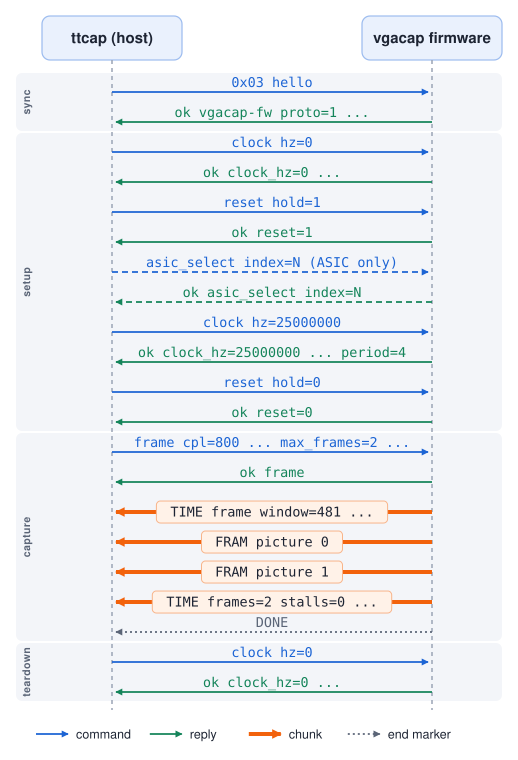

# The vgacap firmware protocol

This page lists what a host sends the vgacap firmware over its USB serial port, and what comes back, for
protocol version 1. It is for someone writing a host, or reading the host side in
[`python/ttcap/firmware.py`](../python/ttcap/firmware.py); the firmware side is
[`firmware/core/fw.c`](core/fw.c). How the firmware captures is on
[Capture inside the vgacap firmware](explanation-capture.md).

Figure 1 is the exchange of one frame capture as `ttcap capture --firmware picosdk` runs it.

<picture>
  <source media="(prefers-color-scheme: dark)" srcset="../docs/diagrams/firmware-protocol-dark.svg">
  
</picture>

*Figure 1: a frame capture of two pictures
([`docs/diagrams/firmware_protocol.py`](../docs/diagrams/firmware_protocol.py)).*

## The link

Item names a property of the serial link, and Value gives it.

| Item | Value |
|---|---|
| Transport | USB CDC ACM, one port |
| Baud rate, parity and stop bits | ignored |
| DTR | must be asserted: the firmware writes only while it is set |
| DTR dropped during a capture | the capture ends, and nothing more is written |
| DTR through the fpgas.online bridge (`fpgas-tt`) | held while the bridge holds the port open, whether or not a client is connected |

## Command lines

Rule names a property of the lines a host sends, and Value gives it.

| Rule | Value |
|---|---|
| Encoding | ASCII |
| Form | a command word, then `key=value` arguments |
| Separator | one or more spaces or tabs |
| End of line | `\n` |
| `\r` and other bytes below `0x20` or equal to `0x7f` | dropped |
| `0x03` while idle | discards the line received so far |
| Empty line | does nothing, and gets no reply |
| Longest line | 256 bytes; a longer line is refused whole |
| Each argument a command takes | given exactly once |
| Default values | none |
| Integer values | decimal, an optional leading `-`, at most 12 digits |
| Replies to one command | exactly one line |
| `ok` reply | `ok`, then `key=value` fields |
| `err` reply | `err`, then a message for a person |
| Known state | send `\x03\nhello\n`, and discard everything before `ok vgacap-fw` |

## Commands

Command is the command word, and Arguments the keys it takes, listed under [Arguments](#arguments). Reply is the `ok`
line, with `N` for a number. Then is what follows the reply.

| Command | Arguments | Reply | Then |
|---|---|---|---|
| `hello` | none | `ok vgacap-fw proto=1 chip=rp2350 sysclk_hz=N arena_bytes=N` | nothing |
| `status` | none | `ok clock_hz=N sysclk_hz=N reset=N ui_in=N` | nothing |
| `clock` | `hz` above 0 | `ok clock_hz=N actual_hz=N sysclk_hz=N period=N` | nothing |
| `clock` | `hz=0` | `ok clock_hz=0 sysclk_hz=N` | nothing |
| `reset` | `hold` | `ok reset=N` | nothing |
| `ui_in` | `value` | `ok ui_in=N` | nothing |
| `asic_select` | `index` | `ok asic_select index=N` | nothing |
| `stream` | five keys | `ok stream` | [capture output](#capture-output) |
| `frame` | twelve keys | `ok frame` | [capture output](#capture-output) |
| `program_stream` | `edge` | `ok words=W wrap_target=N wrap=N shiftctrl=0xH execctrl=0xH` | nothing |
| `program_frame` | five keys | `ok words=W wrap_target=N wrap=N shiftctrl=0xH execctrl=0xH` | nothing |
| `reboot` | none | `ok reboot` | a reboot into the firmware in flash, the stock firmware |
| `bootsel` | none | `ok bootsel` | a reboot into the RP2350's USB bootloader |

## Arguments

Command and Key name an argument, Range gives the values it takes, and Meaning what it sets.

| Command | Key | Range | Meaning |
|---|---|---|---|
| `clock` | `hz` | 0 to 125000000 | project clock on GPIO 16 in Hz; 0 stops it and releases the pin |
| `reset` | `hold` | 0 to 1 | 1 drives the project's `rst_n` (GPIO 14) low; 0 drives it high |
| `ui_in` | `value` | -1 to 255 | drives `ui_in` (GPIO 17 to 24) with the value; -1 releases the pins |
| `asic_select` | `index` | 0 to 1023 | project mux index: the stock firmware's `tt.shuttle.<name>.count` |
| `stream` | `buf_words` | 1 to `arena_bytes` / 8 | 32-bit words in each of the two DMA buffers |
| `stream` | `max_bytes` | 0 to 4294967295 | stop once the chunk bytes sent reach this; 0 for no limit |
| `stream` | `edge` | `falling` or `rising` | project clock edge to sample on |
| `stream` | `pio` | 0 to 2 | PIO block |
| `stream` | `sm` | 0 to 3 | state machine in that block |
| `frame` | `cpl` | 1 to 65535 | project clocks per line, a multiple of 4 |
| `frame` | `region_first` | 0 to 65535 | first line of the region; line 0 is the first line of the vsync pulse |
| `frame` | `region_lines` | 1 to 65535 | lines in the region, with `region_first` + `region_lines` at most 65536 |
| `frame` | `window_lines` | 0 to 65535 | most lines in one window; 0 for the whole region |
| `frame` | `hsync_active` | -1 to 1 | hsync level during its pulse; -1 to measure it |
| `frame` | `vsync_active` | -1 to 1 | vsync level during its pulse; -1 to measure it |
| `frame` | `max_frames` | 0 to 4294967295 | stop after this many pictures; 0 for no limit |
| `frame` | `max_bytes` | 0 to 4294967295 | as for `stream`, the opening `TIME` chunk counted |
| `frame` | `edge` | `falling` or `rising` | project clock edge to sync to |
| `frame` | `sample_delay` | 0 to 31 | system clocks after the edge before each sample |
| `frame` | `pio` | 0 to 2 | PIO block |
| `frame` | `sm` | 0 to 3 | state machine in that block |
| `program_stream` | `edge` | `falling` or `rising` | as for `stream` |
| `program_frame` | `edge` | `falling` or `rising` | as for `frame` |
| `program_frame` | `hsync_active` | 0 to 1 | as for `frame`, without measuring |
| `program_frame` | `vsync_active` | 0 to 1 | as for `frame`, without measuring |
| `program_frame` | `sample_delay` | 0 to 31 | as for `frame` |
| `program_frame` | `period` | 2 to 32 | system clocks per sample |

## Reply fields

Field names a field of an `ok` reply, and Meaning what it holds.

| Field | Meaning |
|---|---|
| `proto` | the protocol version, 1 |
| `chip` | `rp2350` |
| `sysclk_hz` | the system clock running now |
| `arena_bytes` | bytes in the capture buffer |
| `clock_hz` | the project clock asked for; 0 when stopped |
| `actual_hz` | the frequency the PWM makes |
| `period` | system clocks per project clock when that is a whole 2 to 32 within 0.5%; else 0 |
| `reset` | 1 while `rst_n` is held low |
| `ui_in` | the value driven on `ui_in`; -1 while released |
| `words` | the PIO program, comma-separated 16-bit words in hex |
| `wrap_target`, `wrap` | the program's wrap addresses, from its first instruction |
| `shiftctrl`, `execctrl` | the state machine's `SHIFTCTRL` and `EXECCTRL` values |

## Refusals

Command names the command refused, Condition when it is, and Message the text after `err`. `K`, `V`, `N` and `C`
stand for the key, the value, a number and a command word.

| Command | Condition | Message |
|---|---|---|
| any | an unknown command word | `unknown command 'C'` |
| any | a line over 256 bytes | `line longer than 256 bytes` |
| any | an argument with no `=` | `expected key=value, got 'V'` |
| any | a key the command does not take | `unknown key 'K'` |
| any | a key given twice | `key 'K' given twice` |
| any | a key not given | `missing key 'K'` |
| any | a number out of range | `K must be an integer N..N, got 'V'` |
| any | a word not in the list | `K must be falling\|rising, got 'V'` |
| `hello`, `status`, `reboot`, `bootsel` | any argument | `C takes no arguments: ...` |
| `clock` | no system clock gives that project clock | `clock N: no system clock for that project clock (3 Hz .. 125 MHz)` |
| `clock` | the PWM divider cannot reach it | `clock N: the PWM cannot make that clock` |
| `clock` | the system clock did not change | `clock N: the system clock cannot be set to that frequency` |
| `stream` | the project clock is stopped | `the project clock is stopped: send 'clock hz=N' first` |
| `frame` | the project clock is stopped | `the project clock is stopped: send 'clock hz=N' first` |
| `frame` | `cpl` not a multiple of 4 | `cpl N is not a whole number of 4-sample words` |
| `frame` | the region passes line 65535 | `region_first + region_lines must not pass line 65535` |
| `frame` | `period` would be 0 | `sysclk N is not 2..32 whole project clocks of N` |
| `frame` | a line is bigger than the buffer | `not one line of buffer: a line is N bytes` |
| `stream`, `frame` | the PIO block has a program loaded | `the PIO block's GPIO window cannot be moved to 16 (a program is loaded)` |
| `stream`, `frame` | the PIO block is full | `no room for the program in that PIO block` |
| `stream`, `frame` | fewer than two DMA channels are free | `no two free DMA channels` |

After the first two `clock` refusals the clock runs on as it was. After the third it is stopped, and `status`
reports `clock_hz=0`.

## What each command does

Command names the command, and Effect what it changes on the board.

| Command | Effect |
|---|---|
| `clock` | sets the system clock the stock firmware picks for that project clock, then the PWM as MicroPython sets it |
| `reset` | drives GPIO 14, which is left alone until the first `reset` |
| `ui_in` | drives GPIO 17 to 24, which are left alone until the first `ui_in` |
| `asic_select` | GPIO 0, 1 and 2 low; 10 ms; GPIO 1 high; 10 ms; `index` pulses on GPIO 2, 1 ms high and 1 ms low; GPIO 0 high |
| `program_stream`, `program_frame` | nothing: the reply is the program a capture with those operands loads |
| `reboot` | a watchdog reboot, 100 ms after the reply |
| `bootsel` | a reboot into the USB bootloader, 100 ms after the reply |

The `asic_select` reply comes about 20 ms plus 2 ms for each index after the command. GPIO 1 is the iCE40's
`CRESET_B` on an FPGA breakout, so `asic_select` erases the FPGA there.
[How to select an ASIC project with the vgacap firmware](how-to-select-asic-project.md) says when to send it.

## Capture output

After `ok stream` or `ok frame` the firmware writes binary vgacap chunks: a 4-byte tag, a little-endian `u32`
length, then the payload, as [`include/vgacap/stream.h`](../include/vgacap/stream.h) defines them. Order is the
place in the output, Bytes what is written there, and Capture the command that writes it.

| Order | Bytes | Capture |
|---|---|---|
| 1 | a `TIME` chunk, `frame window=W buffers=1 hsync_active=H vsync_active=V` | `frame` |
| 2 | a `RAW ` chunk for each full DMA buffer | `stream` |
| 2 | a `FRAM` chunk for each window | `frame` |
| 2 | a `TIME` chunk, `overrun`, straight after a torn `RAW ` chunk | `stream` |
| 2 | a `TIME` chunk, `rxstall`, before the `FRAM` chunk of a window that stalled | `frame` |
| 3 | a `TIME` chunk, `overruns=N rxstall=N sysclk_hz=N` | `stream` |
| 3 | a `TIME` chunk, `frames=N stalls=N rxstall=N sysclk_hz=N` | `frame` |
| 4 | `DONE`, then a `u32` 0, which is no vgacap chunk | both |

After `DONE` the firmware reads commands again. A capture whose host dropped DTR writes no `DONE`.

Item names a property of the chunks, and Value gives it.

| Item | Value |
|---|---|
| Samples | `uo_out`, one byte each, four to a 32-bit word, the first in the most significant byte |
| `RAW ` chunk | one DMA buffer, sent from the live buffer |
| Overrun | a fill that starts on a buffer still unsent, which tears that buffer's chunk |
| `dropped_samples` of an `overrun` | the total so far, an upper bound |
| `FRAM` chunk | one window, its `frame_counter` the picture number |
| `TIME` fields `host_time_ns` and `clock_hz` | 0 |
| `VGCH` header | none: the host writes it before the firmware's chunks |
| `max_bytes` counted | every chunk sent, headers included, `DONE` excluded |
| A stream sample | one on every chosen edge of the project clock |
| A frame sample | one every `period` system clocks, phase-locked to the project clock |
| A window | `window_lines` lines, or fewer when the capture buffer holds fewer |
| Sync levels measured | 2000 reads 10 µs apart; the idle level is the majority |

## Stopping

Byte names what the host sends, When the firmware's state, and Effect what happens.

| Byte | When | Effect |
|---|---|---|
| `0x03` | during a capture | the capture ends between chunks, with its summary `TIME` chunk and `DONE` |
| `q` | during a capture | as `0x03` |
| any other | during a capture | discarded |
| `0x03` | idle | the line received so far is discarded |

The firmware checks for a stop byte only between chunks: while it waits for a buffer or a window, and after it
sends each chunk.
