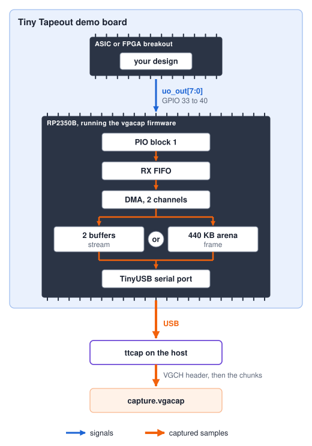

# Capture inside the vgacap firmware

This page explains how the vgacap firmware captures a design's VGA output on the Tiny Tapeout demo board v3. It
covers where a sample goes, the two capture engines and their PIO programs, and what the firmware assumes about
the board. The commands are on [The vgacap firmware protocol](PROTOCOL.md).

## A firmware in place of the stock one

The stock firmware is MicroPython with the Tiny Tapeout SDK. Through it, ttcap sends a MicroPython program over
the raw REPL for each capture. The vgacap firmware is a C program built with
[pico-sdk](https://github.com/raspberrypi/pico-sdk), which holds the same capture code.

It answers a line protocol over its own USB serial port. It runs instead of the stock firmware, loaded into SRAM by the bootloader. A reboot
brings the stock firmware back from flash, which the vgacap firmware never writes.

Its engines are the MicroPython capture programs in [`python/ttcap/mp/`](../python/ttcap/mp/), ported statement
for statement where the order matters. They write the same chunks, stop at the same points and report in the
same `TIME` messages. So everything on the host after the transport is shared with the stock firmware's path,
from the stream header to the frame rebuilding.

## Where a sample goes

Figure 1 is the path of a sample. The design drives `uo_out` on GPIO 33 to 40, and a PIO state machine samples
it. Two DMA channels move the samples from the state machine's RX FIFO into SRAM. The firmware sends full buffers
over TinyUSB's serial port, and ttcap writes them after its own `VGCH` header.

<picture>
  <source media="(prefers-color-scheme: dark)" srcset="../docs/diagrams/firmware-datapath-dark.svg">
  
</picture>

*Figure 1: the firmware's capture data path
([`docs/diagrams/firmware_datapath.py`](../docs/diagrams/firmware_datapath.py)).*

The buffer is where the firmware differs most from the stock firmware's path. MicroPython's heap is fragmented,
so a frame capture there fills many small blocks and may need several frames for one picture. The firmware owns
one static block, [the arena](reference-board.md#memory), which holds the whole 481-line region of 640x480@60. On
fpga-4 that gave one captured frame for each picture. It also gave about 0.74 million samples a second, against
0.28 million through the stock firmware
([dated result](https://github.com/mithro/tt-vga-capture/tree/main/docs/results/2026-11-24-picosdk-firmware-fpga4)).

## The stream engine

A stream takes one sample of `uo_out` on every chosen edge of the project clock, until it is stopped. The two DMA
channels fill two halves of the arena in turn, each chained to start the other as it completes. Each channel's
completion interrupt re-arms it and marks its buffer full. The main loop sends each full buffer as a `RAW ` chunk.

The USB link, not the PIO, limits the project clock. A fill can start on a buffer that has not been sent, and then
that buffer is torn: its chunk mixes two fills. The interrupt counts the overrun and marks the buffer. The main
loop follows the torn chunk with an `overrun` `TIME` chunk before any other. On fpga-4 the firmware streamed
750 kHz for four seconds with no overrun, in the dated result above.

## The frame engine

A frame capture runs the design at its real clock and samples only a window of whole lines. Its PIO program waits
for the vsync leading edge, then counts hsync leading edges to the first line wanted. It then syncs to one project
clock edge. From there it takes a sample every `period` system clocks, phase-locked to the project clock. That
needs the system clock to be a whole multiple of the project clock, which the `clock` command arranges.

Two DMA channels carry the window. A control channel feeds the data channel one control block for each buffer.
After them comes a stopper block, which writes the state machine's enable bit into the PIO's clear alias. The
stopper is the only transfer that interrupts.

The firmware then sends the window as one `FRAM` chunk between frames, and arms the next. The control blocks let
one window span several buffers. [The module firmware](../mpy/explanation-borrowing.md#the-module-firmware) uses
that on its fragmented heap; the vgacap firmware always passes one.

## The PIO programs

[`pio/vgacap_stream.pio`](pio/vgacap_stream.pio) and [`pio/vgacap_frame.pio`](pio/vgacap_frame.pio) are the
programs' readable sources, at the board's default operands. A capture's edge, sync levels, sample delay and
period are known only when it starts. So [`core/fw_pio.c`](core/fw_pio.c) builds the loaded words at run time,
instruction for instruction in the `.pio` order.

Two references hold the builder. The firmware build assembles the `.pio` files with pioasm and fails if the output
differs from the checked-in `.hex`. The host tests compare the built words with that `.hex`. They also compare them
with the words MicroPython's `rp2.asm_pio` assembles for `make_sampler()` and `make_trigger()`, in
[`capture_rp2.py`](../python/ttcap/mp/capture_rp2.py) and [`frame_rp2.py`](../python/ttcap/mp/frame_rp2.py).

## What the firmware assumes about the board

The board is an RP2350B, with 48 GPIOs, and `uo_out` sits on GPIO 33 to 40, past GPIO 31. A PIO block reaches
those only with its GPIO window moved to 16. The SDK refuses that move while the block holds another program. So
a capture takes a block whose window it can move: block 1 by default, as on the stock firmware's path. Here
too ttcap refuses block 0, which only the stock firmware needs ([issue #44](https://github.com/mithro/vgacap/issues/44)).

The firmware cannot load a bitstream or enable a design by name; the stock firmware knows the shuttle. On an FPGA
breakout the design is enabled under the stock firmware first. The iCE40 keeps its configuration while the RP2350
resets into its bootloader and then into this firmware. That held on fpga-4, where every capture after the switch
was pixel-exact.

On an ASIC breakout the project mux's lines float in the bootloader. On the tt09 board the mux came back with nothing
selected. The `asic_select` command replays the stock firmware's mux sequence to select the project again.

GPIO 1 erases an FPGA breakout's configuration when it is low, as [the GPIO table](reference-board.md#gpios) says.
The stock firmware leaves it driven high, and the firmware drives it high first thing at boot. It sets the level
before the direction, so the pin never glitches low. Only `asic_select` drives it low, which is why ttcap refuses
`--asic-index` for a demo board with an FPGA breakout.

The project clock comes from the PWM on GPIO 16. The firmware sets the system clock the stock firmware picks for
that project clock. Its search is the stock firmware's, ported to single-precision arithmetic as MicroPython runs
it. A design therefore runs, and is sampled, at the same ratio under either firmware.

Above 66.5 MHz the system clock may rise to twice the project clock. As in MicroPython, nothing raises the core
voltage for that. No capture at such a clock has run on a board ([issue #32](https://github.com/mithro/vgacap/issues/32)).
