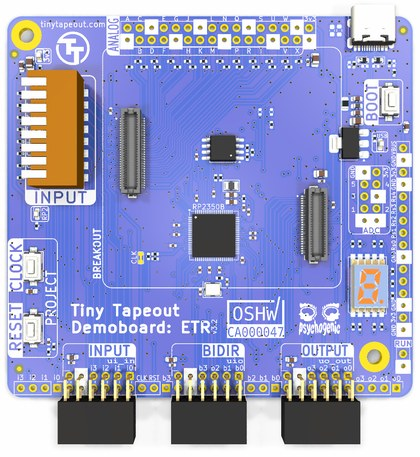

# How to run the vgacap firmware from RAM and go back to stock

**You want the vgacap firmware running on a demo board, and the stock firmware back afterwards.**

The vgacap firmware is built `no_flash`: the RP2350's bootloader loads it into SRAM and runs it, and flash is
never written. A reboot, a reset or a power cycle brings the stock firmware back. Capturing once it runs is on
[How to capture with the vgacap firmware](how-to-capture.md).

## What you need

- One Tiny Tapeout demo board v3 (RP2350B), running the stock firmware, with a USB cable to a Linux machine.

  

- On that machine, a vgacap checkout set up to run `ttcap`, as on [How to run ttcap on a Raspberry Pi](../python/ttcap/how-to-run-on-raspberry-pi.md), and `sudo`.
- `vgacap_fw.uf2`, built as on [How to build the vgacap firmware](how-to-build.md), copied to the checkout's root.
- `<dev>`, the stock firmware's serial port. On the Welland bench it is `/dev/ttboard` on the board's own Pi.
- With an FPGA breakout, the design you want to capture enabled under the stock firmware. The iCE40 keeps it
  across the switch. On the Welland bench this is `<name>`, an uploaded design that step 2 enables. Without a
  design, the captures fail with `board went quiet` ([dated result](https://github.com/mithro/tt-vga-capture/tree/main/docs/results/2026-11-27-docs-bench-fpga1)). An ASIC breakout loses its project, and
  [How to select an ASIC project with the vgacap firmware](how-to-select-asic-project.md) selects it again.

## Steps

1. On the Welland bench, read the fpgas.online bridge's health, which must show `"clients": 0` before you go on.

   ```console
   $ curl -s localhost:8765/health
   ```

2. On the Welland bench, enable the design through the bridge, because `tt.shuttle` does not know uploaded designs.

   ```console
   $ curl -s -X POST localhost:8765/designs/<name>/enable
   ```

3. On the Welland bench, stop the bridge, which frees `/dev/ttboard`.

   ```console
   $ sudo systemctl stop fpgas-tt
   ```

4. At the checkout's root, reboot the board into its bootloader, which brings up a USB drive labelled `RP2350`.

   ```console
   $ uv run --no-sync ttcap reboot serial:<dev> --to bootsel
   ```

5. At the checkout's root, copy the UF2 to that drive, which disappears as the vgacap firmware starts.

   ```console
   $ sudo mkdir -p /mnt/rp2350
   $ sudo mount /dev/disk/by-label/RP2350 /mnt/rp2350
   $ sudo cp vgacap_fw.uf2 /mnt/rp2350/ && sync
   $ sudo umount /mnt/rp2350
   ```

6. In the shell, name the vgacap firmware's serial port, which appears within a few seconds.

   ```console
   $ FW=$(ls /dev/serial/by-id/usb-vgacap_vgacap_capture_firmware_*-if00)
   ```

7. Capture with the firmware, as on [How to capture with the vgacap firmware](how-to-capture.md), using `serial:$FW` as the link.

8. At the checkout's root, reboot the vgacap firmware, which brings the stock firmware back from flash.

   ```console
   $ uv run --no-sync ttcap reboot serial:$FW
   ```

9. On the Welland bench, start the bridge again, whether or not the steps before succeeded.

   ```console
   $ sudo systemctl start fpgas-tt
   ```

## Check

After step 6, `lsusb` shows the vgacap firmware:

```text
ID 2e8a:0009 vgacap vgacap capture firmware
```

Step 8 prints `the board runs picosdk`, then `rebooting to flash`. After it, `lsusb` shows the stock firmware
again, and on the Welland bench `/dev/ttboard` is back:

```text
ID 2e8a:0005 MicroPython Board in FS mode
```

## If it fails

| What you see | Likely cause | Fix |
|---|---|---|
| `"clients":` above 0 at step 1 | someone is using the board through the bridge | Wait until the count is 0; do not stop the bridge under a client |
| Step 4 cannot open `<dev>` | something else holds the port | Close it, or stop the bridge as in step 3 |
| No `RP2350` drive after step 4 | the board did not reach its bootloader | At the bench, hold BOOTSEL while resetting the board |
| `umount` reports the drive already gone | the board rebooted when the copy ended | Nothing: the copy is complete |
| No `usb-vgacap_*` port after step 5 | the UF2 is not the vgacap firmware, or the copy was cut short | Repeat steps 4 and 5 with a freshly built UF2 |
| A udev rule or tool looks for `/dev/ttboard` and finds nothing | the vgacap firmware's port has its own name | Use the `/dev/serial/by-id/usb-vgacap_*` path from step 6 |
| Step 8 cannot reach the firmware | the port is gone or held | Reset or power-cycle the board, which also brings back the stock firmware |

## Next

- [How to capture with the vgacap firmware](how-to-capture.md)
- [How to select an ASIC project with the vgacap firmware](how-to-select-asic-project.md)
- [Capture inside the vgacap firmware](explanation-capture.md)
- [The vgacap firmware's GPIOs, USB identity, buffer and clocks](reference-board.md)
