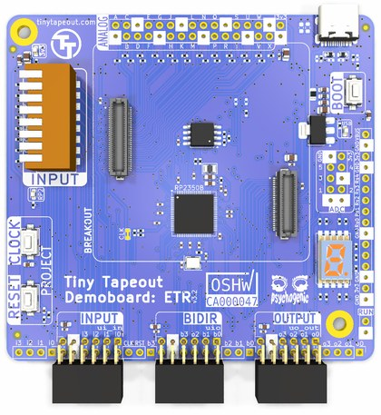

# How to flash the module firmware and restore the board's own

**You want a demo board running a MicroPython firmware with the vgacap module, and afterwards its own firmware
back, byte for byte.**

Unlike the vgacap firmware, the module lives in the board's flash. So this page backs up the board's firmware
region and every file first, writes only the firmware region, and restores the backup at the end. It is the
method of the
[fpga-1 run](https://github.com/mithro/tt-vga-capture/tree/main/docs/results/2026-11-24-mpy-module-fpga1), which
needed no power cycle.

## What you need

- One Tiny Tapeout demo board v3 (RP2350B), running the stock firmware, with a USB cable to a Linux machine.

  

- On that machine: `sudo`, Python 3, `curl` and [mpremote](https://docs.micropython.org/en/latest/reference/mpremote.html).
- `DEV`, the stock firmware's serial port, set in the shell. On the Welland bench it is `/dev/ttboard` on the board's own Pi.
- `IMAGE`, the module firmware's UF2, set in the shell: the `tt-demo-rp2350-vgacap-module-*.uf2` asset of the
  [`dev-vgacap-module` pre-release](https://github.com/mithro/tt-micropython-firmware/releases/tag/dev-vgacap-module),
  or the `firmware.uf2` from [How to build a demo-board firmware with the module and the SDK](how-to-build-release.md).
- An empty working directory, with about 10 MB free.

The board's flash holds the firmware region, `0x10000000` to `0x100C8000`, then the littlefs filesystem from
`0x100C8000`. Every image written here stops at `0x100C8000`, so the filesystem is never written.

## Steps

1. In the working directory, fetch the backup and image tools from tt-vga-capture, which gives seven Python files.

   ```console
   $ for f in fw_probe.py fw_dump.py fs_dump.py manifest.py unpack_backup.py uf2tool.py fs_start.py; do curl -fsSLO https://raw.githubusercontent.com/mithro/tt-vga-capture/e4427aaadae934539590bf9ae89c17ed451bdf71/docs/results/2026-11-24-mpy-module-fpga1/$f; done
   ```

2. On the Welland bench, check that the fpgas.online bridge has no clients and stop it, which frees `/dev/ttboard`.

   ```console
   $ curl -s localhost:8765/health
   $ sudo systemctl stop fpgas-tt
   ```

3. In the working directory, back up the board and check the backup against the board's own hashes, which prints `MATCH` and `0 do not`.

   ```console
   $ mpremote connect $DEV run fw_probe.py > probe_before.txt
   $ mpremote connect $DEV run manifest.py > manifest_before.txt
   $ mpremote connect $DEV run fw_dump.py > fw_dump.txt
   $ mpremote connect $DEV run fs_dump.py > fs_dump.txt
   $ python3 unpack_backup.py fw_dump.txt fs_dump.txt manifest_before.txt probe_before.txt backup
   ```

4. In the working directory, make the module image and the restore image, both covering the whole firmware region, which prints their hashes.

   ```console
   $ python3 uf2tool.py tobin $IMAGE module.bin 0x10000000 0x100C8000
   $ python3 uf2tool.py frombin module.bin module.uf2 0x10000000 0xe48bff59
   $ python3 uf2tool.py frombin backup/firmware_region.bin restore.uf2 0x10000000 0xe48bff59
   $ python3 uf2tool.py tobin restore.uf2 restore.bin 0x10000000 0x100C8000
   $ sha256sum module.bin restore.bin backup/firmware_region.bin
   ```

5. In the working directory, write the module image and probe the board, which shows `fw_sha256` equal to `module.bin`'s hash and `vgacap.API` as `1`.

   ```console
   $ mpremote connect $DEV bootloader
   $ until [ -e /dev/disk/by-label/RP2350 ]; do sleep 1; done
   $ sudo mkdir -p /mnt/rp2350 && sudo mount /dev/disk/by-label/RP2350 /mnt/rp2350
   $ sudo cp module.uf2 /mnt/rp2350/ && sync; sudo umount /mnt/rp2350
   $ until [ -e $DEV ]; do sleep 1; done; sleep 3
   $ mpremote connect $DEV run fw_probe.py > probe_module.txt
   $ mpremote connect $DEV exec "import vgacap; print(vgacap.API)"
   ```

6. Capture with the module, as on [How to capture with the vgacap MicroPython module](how-to-capture.md), for as long as you need it.

7. In the working directory, write the restore image and probe the board again, whether or not the steps before succeeded.

   ```console
   $ mpremote connect $DEV bootloader
   $ until [ -e /dev/disk/by-label/RP2350 ]; do sleep 1; done
   $ sudo mount /dev/disk/by-label/RP2350 /mnt/rp2350
   $ sudo cp restore.uf2 /mnt/rp2350/ && sync; sudo umount /mnt/rp2350
   $ until [ -e $DEV ]; do sleep 1; done; sleep 3
   $ mpremote connect $DEV run fw_probe.py > probe_after.txt
   $ mpremote connect $DEV run manifest.py > manifest_after.txt
   ```

8. On the Welland bench, start the bridge again.

   ```console
   $ sudo systemctl start fpgas-tt
   ```

## Check

The hashes match at each point. In step 4, the hashes of `restore.bin` and `backup/firmware_region.bin` are
equal. After step 7, the board's firmware region is its own again, and so is every file:

```console
$ grep fw_sha256 probe_before.txt probe_after.txt
$ diff <(grep '^F ' manifest_before.txt) <(grep '^F ' manifest_after.txt) && echo files identical
$ mpremote connect $DEV exec "import vgacap"
```

The two `fw_sha256` lines show the same hash, `diff` prints `files identical`, and `import vgacap` fails with
`ImportError`, as on the stock firmware. On fpga-1 the hashes were `69745ff3…` before and after, with all 65 files
identical.

## If it fails

| What you see | Likely cause | Fix |
|---|---|---|
| `"clients":` above 0 at step 2 | someone is using the board through the bridge | Wait until the count is 0 |
| `MISMATCH` or `1 do not` at step 3 | a dump was cut short | Run step 3 again; never go on with a backup that does not match |
| `restore.bin` and `backup/firmware_region.bin` hash differently at step 4 | the restore image is wrong | Make it again; do not write anything until they match |
| No `RP2350` drive after `bootloader` | the board did not reach its bootloader | At the bench, hold BOOTSEL while resetting the board |
| `fw_sha256` after step 5 differs from `module.bin` | the copy was cut short | Repeat the writing commands of step 5 |
| `ImportError` for `vgacap` after step 5 | `IMAGE` is a firmware without the module | Restore with step 7, and start again with the right image |
| A capture fails for want of `ttboard` | `IMAGE` is CI's rp2 compile check, which has no SDK | Restore with step 7, and use a release or a build from the release how-to |
| The files differ after step 7 | the module firmware mounted a filesystem at another address | Restore the files from `backup/fs/` with `mpremote fs cp` |

`python3 fs_start.py $IMAGE` lists where a UF2 that holds a filesystem has the word `littlefs`. A release UF2's
list includes `0x100c8008`, the superblock of a filesystem at `0x100C8000`, as the stock firmware's does.

## Next

- [How to capture with the vgacap MicroPython module](how-to-capture.md)
- [The vgacap module inside MicroPython](explanation-borrowing.md)
- [How to build a demo-board firmware with the module and the SDK](how-to-build-release.md)
