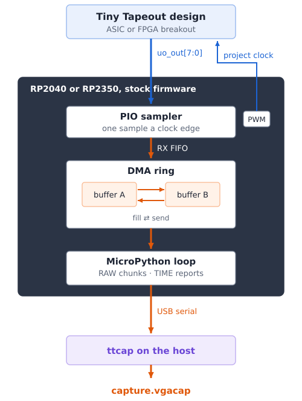

# Capture on the demo board

**How a capture with the stock firmware gets from a design's pins to a `.vgacap` file, and how samples can be lost on the way.**

It is for someone who has run `ttcap capture` and wants to know what the board and the host do. It does not give the steps, which are on [How to capture a stream from a demo board](how-to-capture-stream.md), nor the stream's byte layout.

<picture>
  <source media="(prefers-color-scheme: dark)" srcset="diagrams/data-path-dark.svg">
  
</picture>

*The data path of a stream capture, drawn by [`diagrams/data_path.py`](diagrams/data_path.py).*

## Nothing installed on the board

The stock firmware runs MicroPython, and `ttcap` drives it through its raw REPL. For each capture, `ttcap` sends a short program from [`mp/`](mp/), with its settings prepended, and the board runs it. So the board needs no capture firmware, and a capture leaves nothing behind but the design it enabled. The program for a stream is [`mp/capture_rp2.py`](mp/capture_rp2.py), joined to the shared [`mp/prelude.py`](mp/prelude.py).

## The pins and the clock

The design's eight `uo_out` pins reach the demo board's microcontroller, which also makes the project clock with one of its PWM outputs. The sampler is a slave to that clock: it waits for an edge, then reads the pins. A stream samples on the falling edge, by which time the outputs have settled. The pins differ between the two chips, as [Demo board GPIO maps for capture](reference-gpio-maps.md) lists.

On the RP2040 the `uo_out` pins are not adjacent, so the sampler reads a 12-pin window, two samples to a 32-bit word. On the RP2350 they sit on GPIO 33 to 40, read as one byte, four samples to a word. The sampler uses PIO block 1 unless told otherwise. The stock firmware keeps its own program in block 0, which on an RP2350 also stops that block from reaching GPIO 33.

## The DMA ring

The PIO pushes each full word into its RX FIFO, and two DMA channels move the words into two buffers in SRAM. Each channel is chained to the other, so when buffer A is full, the DMA goes on into buffer B at once. Each channel's interrupt handler re-arms it for its next turn. Meanwhile the MicroPython loop sends the full buffer over USB as a `RAW` chunk. The PIO is never held up while a buffer is sent.

## USB and the host

The raw REPL ends its output with a 0x04 byte and does not escape it, so `ttcap` reads each chunk by its length instead. The board does not know the signal map or the project clock it is given, so `ttcap` writes the stream's `VGCH` header itself. It then copies the board's chunks after the header byte for byte. To stop, `ttcap` sends one byte, and the board finishes its chunk and sends a closing `TIME` chunk. That last chunk carries the board's count of overruns, its RX stall flag and its system clock.

The link bounds the fastest clock a stream keeps up with. An RP2350 demo board sends about 710 KB/s, one byte a sample ([result](https://github.com/mithro/tt-vga-capture/tree/main/docs/results/2026-11-26-docs-bench-ttcap)). On the stock firmware 3.1.1 its streams overran below that clock ([#52](https://github.com/mithro/vgacap/issues/52)). The fastest clean clock of each source is on [Capture sources compared](../../docs/reference-capture-sources.md).

An RP2040 demo board takes two bytes a sample and kept up at 60 kHz ([result](https://github.com/mithro/tt-vga-capture/tree/main/docs/results/2026-09-15-ttcap-capture-serial-tt07)). A faster clock is allowed, and the loss is reported.

## Overruns and torn chunks

The loop has one buffer's fill time to send the other buffer. When it is late, the DMA starts refilling a buffer that has not been sent in full. The board counts that as an overrun and marks the buffer torn: its chunk will mix old and new samples. Right after sending a torn chunk, the board sends an `overrun` `TIME` chunk, so a torn chunk is never followed by another without its report.

Each overrun report carries the samples dropped so far, as a running total, and the last one is the run's total. It is an upper bound, because a refill that never overtook the send lost nothing. `vgacap-frames` and `vgadecode` drop the picture in progress at the report, so no picture is built across the gap. `ttcap` prints the total as `overruns=` and `dropped=` in its stats.

## RX stalls

The PIO's RX FIFO holds eight words. If the DMA falls that far behind, the PIO stalls and samples are lost before they reach a buffer. The PIO records that in a flag, `FDEBUG.RXSTALL`, which the board clears at the start and reads at the end. `rxstall=1` in the stats therefore means samples were lost, whatever the overrun count says.

## Frame and window capture

A frame capture runs the design at its real clock and captures one frame into SRAM, then sends it while later frames pass. The sampler waits for a vertical sync, counts horizontal syncs to its first line, and then samples in step with the project clock. A table of DMA control blocks lets two channels fill many separate buffers, because the free heap is in pieces. An RX stall there means the picture of that capture is wrong. The program is [`mp/frame_rp2.py`](mp/frame_rp2.py), and the steps are on [How to capture whole frames at the design's own clock](how-to-capture-frames.md).

The run-length mode has the PIO count runs as it samples, which is on [Run-length capture](explanation-run-length-capture.md).
