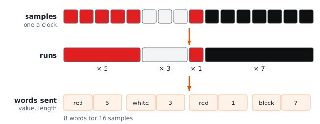

# Run-length capture

**This page explains how `ttcap capture --mode rle` has the demo board's PIO count runs of equal samples, and when that beats a plain stream.**

It is for someone choosing between a stream, a frame capture and a run-length capture. The steps are on [How to capture a run-length encoded stream](how-to-capture-rle.md), and the path from pins to host on [Capture on the demo board](explanation-demo-board-capture.md).

<picture>
  <source media="(prefers-color-scheme: dark)" srcset="diagrams/rle-line-dark.svg">
  
</picture>

*Samples, runs and the words sent for them, drawn by [`diagrams/rle_line.py`](diagrams/rle_line.py).*

## Runs instead of samples

A VGA picture often holds the same colour for many clocks, and the sync signals change only twice a line. A stream sends every one of those samples. A run-length capture sends one 32-bit value and one 32-bit length for each run of equal samples, so a long run costs eight bytes. The host expands the runs back into exactly the samples a stream would have held.

## When it pays

The cost follows the picture, not the clock. For a 640x480 frame, which a stream sends as 105,000 words on an RP2350, the calibration designs needed these numbers of words ([research note](https://github.com/mithro/tt-vga-capture/blob/main/docs/research/2026-11-24-pio-run-counting.md)):

| Design | Words a frame | Share of a stream |
|---|---|---|
| `tt_um_vgacal_counter` | 5780 | 5.5% |
| `tt_um_vgacal_bars` | 63540 | 61% |
| `tt_um_vgacal_grid` | 138100 | 132% |
| `tt_um_vgacal_prbs` | 597966 | 570% |

So a picture of large areas streams at a clock the link could not carry sample by sample. A busy one is better streamed plainly. On the TT09 chip, 1.5 million samples of `tt_um_vga_clock` came in 82 KB, against 1.4 MB for a stream of about the same length ([result](https://github.com/mithro/tt-vga-capture/tree/main/docs/results/2026-11-24-pio-rle-tt09)).

## Counting in the PIO

The PIO program, [`mp/rle_rp2.py`](mp/rle_rp2.py), reads the pins once a project clock and compares them with the current run's value. Equal adds one to the run; different pushes the value and the run and starts a new run. Each path through the loop is five or six instructions when the sample takes one instruction, which only an RP2350 can do. It is one instruction longer when the sample takes two, which works on either chip; an RP2040 has run it only in the emulator ([#38](https://github.com/mithro/vgacap/issues/38)). 

The loop does not count a run's first sample, so the board adds one to each run before it sends a buffer. A run that reaches 2^32 samples is sent as two pairs.

## Two ways to keep in step

The program must take exactly one sample a clock. In the locked style, it waits for one clock edge and then counts system clocks. The system clock must be a whole multiple of the project clock. It must be at least 6 times the project clock with a one-instruction sample, and 7 times with a two-instruction one.

In the edge style, it waits for every clock edge, which needs no whole ratio but a slower project clock. The board picks locked when the ratio is whole and in range, and edge otherwise. Its first report names the style and the ratio. On an RP2350, `ttcap` lets the firmware raise the system clock to 150 MHz, so a 25 MHz design gets a ratio of 6.

## One burst at full speed

`--rle-oneshot` has the board fill its two buffers once, with no sending between, and then send them. That gives an unbroken stretch at the design's real clock, however busy the picture. The stretch ends when the buffers are full of pairs. On an FPGA breakout, one-shot bursts at 25 MHz matched the design exactly.

## Why an RX stall ends the capture

If the PIO's RX FIFO is full, the next pushed word is lost, and every later value and length is out of step. So at the first RX stall the board sends an `error=rxstall` report and stops, without sending the buffer in hand. Every chunk sent before it was whole. `ttcap` then exits 1, because the capture ended early.

An overrun is handled as in a stream: the late buffer's chunk is marked torn, and the readers drop the picture in progress there. Its count of dropped samples is an estimate, one sample for each lost pair, because a lost pair can stand for many samples.
