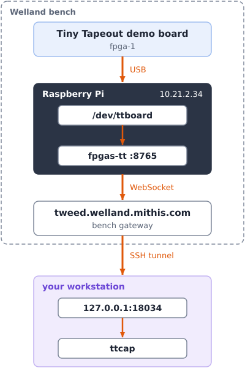

# How to capture from a Welland board through the bridge

**You want to capture a demo board on the Welland bench from your own machine, through the board's fpgas.online bridge (`fpgas-tt`).**

Each bench board hangs off its own Raspberry Pi, and the bridge on that Pi carries the board's serial port over a WebSocket. The bridge is on the bench network, which your machine reaches through an SSH tunnel to the bench gateway. The bench boards are shared and public, so this page starts by checking that nobody else is using the board. To capture on the board's own Pi instead, see [How to capture on a Welland board's own Pi](how-to-capture-welland-pi.md).

The capture takes this path from the board to your machine, here for fpga-1.

<picture>
  <source media="(prefers-color-scheme: dark)" srcset="diagrams/welland-bridge-dark.svg">
  
</picture>

## What you need

- SSH access to the Welland bench gateway, `tweed.welland.mithis.com`.
- A vgacap checkout with `uv sync` run in it, on your machine.
- The board's slug, bridge address and tunnel port, from [Welland bench boards in ttcap](reference-welland-boards.md). This page uses fpga-1.
- A checkout of [tt-vga-testpatterns](https://github.com/mithro/tt-vga-testpatterns), whose `bitstreams/` hold the calibration designs, such as `tt_um_vgacal_bars.bin`.

## Steps

1. In a browser, open `https://tinytapeout.fpgas.online/board/fpga-1/status.json`, and go on only if it shows `"clients": 0` and `"reachable": true`.
2. In the same `status.json`, check that `usb_serial` is the board's serial in [Welland bench boards in ttcap](reference-welland-boards.md#usb-serials), since boards move between Pis.
3. In a second terminal, open the tunnel to the board's bridge, which stays open until you press Ctrl-C there:

   ```sh
   ssh -N -L 18034:10.21.2.34:8765 tweed.welland.mithis.com
   ```

4. In the tt-vga-testpatterns checkout, upload and enable the design through the tunnel with [`tools/upload.py`](https://github.com/mithro/tt-vga-testpatterns/blob/main/tools/upload.py), which loads it into the FPGA:

   ```sh
   uv run --no-project python tools/upload.py http://127.0.0.1:18034 bitstreams/tt_um_vgacal_bars.bin --enable
   ```

5. In the vgacap checkout, capture through the near end of the tunnel, which drives the board through its bridge:

   ```sh
   uv run ttcap capture ws://127.0.0.1:18034/serial --board fpga-1 --design tt_um_vgacal_bars \
       --clock-hz 400000 --seconds 10 --out bench.vgacap
   ```

6. In the vgacap checkout, restart the board to the stock firmware's start state:

   ```sh
   uv run python tools/board_restart.py ws://127.0.0.1:18034/serial
   ```

7. In the browser, reload `status.json` until `idle_display` shows `"state": "loaded"`, which takes about 75 seconds.
8. In the second terminal, press Ctrl-C, which closes the tunnel.

A bitstream uploaded this way is loaded on the FPGA but is not one of the stock firmware's named designs, so `ttcap` reports `enable=already enabled`. The bridge is not stopped on this path, so nothing has to be started again. Step 6 is [How to restart a demo board to the stock firmware's start state](../../tools/how-to-restart-a-board.md). `--board` lets `ttcap` refuse an option the board cannot take. `ttcap demo` takes the same `--link`, and on a failure through a bench address it prints the tunnel command for that board.

## Check

Step 5 ends with a stats line showing `overruns=0 dropped=0 rxstall=0` and `wrote bench.vgacap`. Through the bridge, 400 kHz was clean and 500 kHz overran once or twice in 10 seconds ([result](https://github.com/mithro/tt-vga-capture/tree/main/docs/results/2026-11-26-docs-bench-ttcap)). After step 7, `status.json` shows `"clients": 0` and `"state": "loaded"`, as it did before you started.

## If it fails

| Step | What you see | Likely cause | Fix |
|---|---|---|---|
| 1 | `"clients"` above 0 | someone else is using the board | stop here and use another board |
| 1 | `"reachable": false` | the board's Pi is down or the board is not connected | use another board |
| 2 | a different `usb_serial` | the board has moved to another Pi | find the board by its serial on the site |
| 3 | `Privileged ports can only be forwarded by root` | the local port is below 1024 | use the tunnel port from the table |
| 4 | `Connection refused` | the tunnel is not open | repeat step 3 |
| 5 | `is not a shuttle entry on this board and is not the enabled design either` | the design was not uploaded and enabled | repeat step 4 |
| 7 | `idle_display` `state` stays other than `loaded` | the board did not restart | run step 6 again |
| 7 | `safe_start` `state` starts with `left:` on an ASIC breakout | the bridge found a design still enabled | run step 6 again |

## Next

- [How to capture on a Welland board's own Pi](how-to-capture-welland-pi.md)
- [Welland bench boards in ttcap](reference-welland-boards.md)
- [How to make a video of a design with ttcap demo](how-to-make-video.md)
