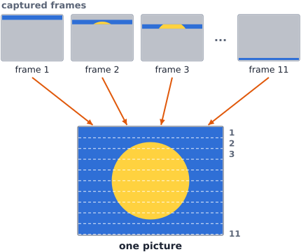

# How to capture a window of lines from each frame

**You want frame capture at the design's real clock, with each captured frame giving only a set number of lines.**

`ttcap capture --mode window` is frame capture with `--window-lines` lines a frame, 48 unless given. The board sweeps the window down the picture over successive frames, and the reconstruction joins the windows into one picture. The picture is exact for a design that draws the same thing every frame, and torn for one that changes from frame to frame.

For a 640x480 design with 48 lines a frame, the sweep takes 11 captured frames.

<picture>
  <source media="(prefers-color-scheme: dark)" srcset="diagrams/window-sweep-dark.svg">
  
</picture>

## What you need

- An RP2350 demo board, where a frame capture works as in [How to capture whole frames at the design's own clock](how-to-capture-frames.md). On an RP2040 demo board, window capture has run only in the emulator ([#37](https://github.com/mithro/vgacap/issues/37)).
- A design that draws the same picture on successive frames, or a reason to want a torn one.

## Steps

1. In the checkout, run the capture in window mode with the lines a frame you want, which writes the swept pictures to the file:

   ```sh
   uv run ttcap capture serial:/dev/ttyACM0 --design tt_um_vgacal_grid \
       --mode window --window-lines 48 --clock-hz 25000000 --frames 1 --out window.vgacap
   ```

2. In the terminal, read the note after the stats, which says how many captured frames each picture is made of.
3. In the checkout, run `mkdir -p out && uv run ttcap png window.vgacap out/window`, which writes the joined picture as a PNG.

`--frames 1` stops after one whole picture. `--window-lines 0` in window mode takes the default of 48. In frame mode, a `--window-lines` above 0 caps each capture at that many lines.

## Check

Step 2 prints a note such as this one, from a 640x480 design:

```text
note: each picture is assembled from 11 captured frames (48 of its 481 lines per frame): exact for a static design, torn for one that changes from frame to frame
```

On an FPGA breakout, a 48-line window of `tt_um_vgacal_grid` at 25 MHz was pixel-identical to its reference ([result](https://github.com/mithro/tt-vga-capture/tree/main/docs/results/2026-11-24-frame-capture-fpga4)). The same window of `tt_um_vgacal_counter`, which changes every frame, was torn as expected. Window capture with an ASIC breakout has not been checked ([#41](https://github.com/mithro/vgacap/issues/41)).

## If it fails

| Step | What you see | Likely cause | Fix |
|---|---|---|---|
| 1 | `is not a shuttle entry on this board` | the board has no design of that name | use `--project` on an ASIC breakout and `--design` on an FPGA one |
| 2 | `rxstall=1` in the stats | samples were lost inside a window | capture again |
| 3 | bands that do not line up in the picture | the design changed between the frames of the sweep | use `--mode frame`, or a larger `--window-lines` |

## Next

- [How to capture whole frames at the design's own clock](how-to-capture-frames.md)
- [How to turn a capture into PNG images](how-to-render-png.md)
- [Capture on the demo board](explanation-demo-board-capture.md)
