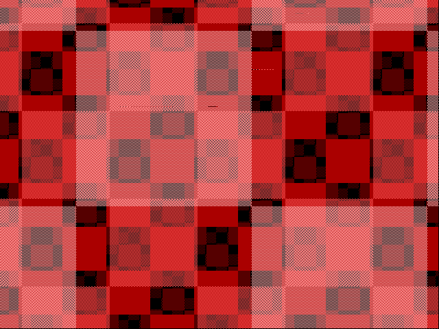

# Your first capture from a demo board

**This tutorial takes you from a demo board on your desk to one PNG of the picture its design draws.**

It is for someone with a Tiny Tapeout demo board running the stock firmware, plugged into a Linux computer by USB, and a design that drives the [Tiny VGA Pmod](https://github.com/mole99/tiny-vga). It does not cover the other capture modes, video, or the boards on the Welland bench; [Next](#next) links to those.



This is what you will have at the end: a frame of `tt_um_rejunity_vga`, captured from a Tiny Tapeout 7 chip on an RP2040 demo board. It came from the commands below, run on [2026-09-15](https://github.com/mithro/tt-vga-capture/tree/main/docs/results/2026-09-15-ttcap-capture-serial-tt07).

## Before you start

You need [Git](https://git-scm.com), [CMake](https://cmake.org) with a C compiler, and [uv](https://docs.astral.sh/uv/). Your user needs to open the board's serial port, which on Debian means being in the `dialout` group. You need the name of your design: a `tt_um_` project name on an ASIC breakout, or the bitstream's name on an FPGA breakout.

## 1. Get vgacap and build its tools

Clone the repository and build the C tools, which turn a capture into frames:

```sh
git clone https://github.com/mithro/vgacap.git
cd vgacap
cmake -S . -B build && cmake --build build
uv sync
```

The build ends with `[100%] Built target` lines, and `build/vgacap-frames` now exists. `uv sync` installs `ttcap` and its Python packages into `.venv`.

## 2. Find the board

Plug the demo board in by USB. It appears as a serial device, `/dev/ttyACM0` when it is the only one. Ask it what it is:

```sh
uv run ttcap probe serial:/dev/ttyACM0
```

It answers with its MicroPython version and its pin map. On an RP2350 demo board the answer starts like this:

```text
sys.version: 3.4.0; MicroPython b006887db6 on 2026-08-11
GPIOMap.all(): {'mng00': 3, 'mng01': 4, ... 'rp_projclk': 16, 'uo_out0': 33, ...}
```

`ttcap` reads the same map during a capture to pick the board's pin layout. A `probe failed:` line instead means the port is wrong or busy; [How to probe a demo board](how-to-probe-board.md) lists the causes.

## 3. Capture two frames

Run the capture, putting your design's name after `--project`. On an FPGA breakout, write `--design` in place of `--project`.

```sh
uv run ttcap capture serial:/dev/ttyACM0 --project tt_um_rejunity_vga \
    --clock-hz 60000 --frames 2 --seconds 0 --out capture.vgacap
```

`ttcap` enables the design, clocks it at 60 kHz, and records its `uo_out` pins on every clock. 60 kHz is a clock both the RP2040 and the RP2350 demo boards stream without loss. Two frames take four frame periods of samples, about 28 seconds at that clock. The run ends with lines like these, from the capture pictured above:

```text
profile=rp2040-tt06map project=tt_um_rejunity_vga enable=index
bytes=3360410 samples=1675264 chunks=819 seconds=28.377 overruns=0 dropped=0 rxstall=0 samples_per_s=59037 mem_free=82928
  board: overruns=0 rxstall=0 sysclk_hz=132000000
wrote capture.vgacap
```

`overruns=0` and `rxstall=0` say no sample was lost. The numbers differ on an RP2350 demo board, which reports `profile=rp2350-dbv3`.

## 4. Turn the capture into a PNG

Rebuild the frames from the capture and write them as PNGs:

```sh
mkdir -p out
uv run ttcap png capture.vgacap out/frame
```

Each frame found is listed, then the count written:

```text
frame 0: 640x480 mode=640x480@60 cpl=800 lpf=525 hsync=pos vsync=pos partial=0 glitches=0
frames=1 glitches_total=0
wrote 1 png(s)
```

Open `out/frame-0000.png`. It is the picture your design drew, rebuilt from its sync signals and its six colour bits. The first frame of a capture is never whole, so a two-frame capture gives one or two PNGs.

## Next

- [How to capture a stream from a demo board](how-to-capture-stream.md), with every limit and option.
- [How to capture whole frames at the design's own clock](how-to-capture-frames.md), for a design that must run at full speed.
- [How to make a video of a design with ttcap demo](how-to-make-video.md).
- [Capture on the demo board](explanation-demo-board-capture.md): what happened between the pins and the file.
