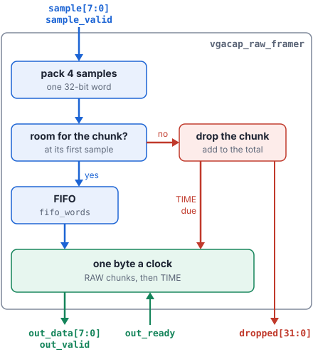

# The raw framer

This page explains how `vgacap_raw_framer` turns samples into vgacap chunks inside an FPGA, and what it does when its sink falls behind. It is for someone deciding whether it fits a capture design. Its ports and byte layouts are on [The raw framer's ports, parameters and output](reference-raw-framer.md).

<picture>
  <source media="(prefers-color-scheme: dark)" srcset="framer-dark.svg">
  
</picture>

## Chunks of a fixed size

The framer takes one 8-bit sample on each clock with `sample_valid` high, and packs four into a 32-bit word. Every `RAW ` chunk holds the same number of samples, 256 unless the design asks for another. So the chunk's header is known before its first sample, and goes out first. The framer streams the words through a FIFO, and never holds a whole chunk to learn its length.

## Whole chunks, or none

At the first sample of a chunk, the framer checks whether the FIFO has room for all of it. If it has, the chunk is admitted and every word of it will fit. If not, all of its samples are dropped and added to `dropped`, a running total. A sink that stalls therefore never tears a chunk, and never leaves a gap that nothing reports.

A `TIME` chunk reports the total, with the message `overrun`. It goes out after the `RAW ` chunk being sent, or at once if nothing is. Only the total is meaningful, not where the `TIME` chunk sits. A `RAW ` chunk admitted before a drop can come out after the report that counts it.

## One byte a clock

The output is a byte with a valid and ready handshake, so any link can take it: pins, a UART or a USB FIFO. A byte not taken stays offered until it is. At best a byte goes out every clock, but each chunk also costs 12 header bytes and 4 idle clocks. With 256 samples a chunk, a sink that is always ready keeps up only with samples on 256 of every 272 clocks. Faster input, or a slower sink, is what the dropping is for.

## No flush

The framer has no way to end a chunk early. If `sample_valid` stops in the middle of a chunk, the stream ends in a cut-short `RAW ` chunk, whose header has already gone. A `TIME` report still due behind it is never sent. Every chunk before that one reads correctly, so a capture that stops on a chunk boundary ends cleanly.

## The header and the code

The framer writes chunks only. The `VGCH` header, which holds the signal map, the mode and the clock, is the host's to write, because only the host knows them. The framer is one Migen module that imports nothing else from vgacap. Its Verilog is generated from it and committed, so a design in plain Verilog needs no Python.

## Proven on an FPGA

A test design on an iCE40UP5K FPGA breakout fed the bars picture through the framer, and the demo board's RP2350 captured its bytes. At 250 kHz, 249,600 samples came back as the bars picture with no overrun. At the design's 25 MHz, one-shot windows of 63 and 127 chunks were each one unbroken run ([the result](https://github.com/mithro/tt-vga-capture/tree/main/docs/results/2026-11-24-rtl-framer-fpga4)).
