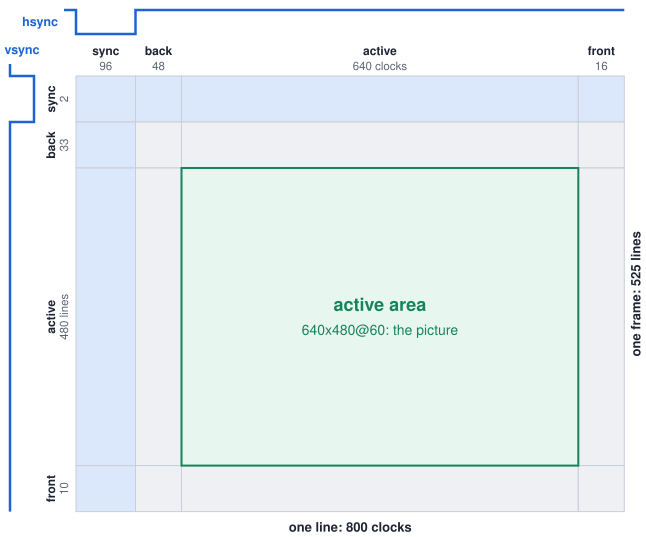

# How libvgaframe rebuilds frames

This page explains how libvgaframe, the C library in [`src/frame/`](.), turns a capture's samples back into pictures. It is for someone reading `vgacap-frames` output or wondering why a capture gave fewer frames than expected. The modes it knows are on [The VGA mode table](reference-modes.md), and the bytes it reads on [The vgacap stream format](../stream/reference-stream-format.md).

<picture>
  <source media="(prefers-color-scheme: dark)" srcset="../../docs/diagrams/vga-timing-dark.svg">
  
</picture>

## A frame as libvgaframe lays it out

A line starts at the leading edge of its hsync pulse, and a frame at the line where the vsync pulse begins. So each line runs sync, back porch, active area, front porch, and each frame the same in lines. The picture is the active area: it starts sync plus back porch clocks into the line, and sync plus back porch lines into the frame. Every sample is one clock, and one clock is one pixel at the mode's own pixel clock.

## Learning the sync from the signal

Nothing tells libvgaframe the timing in advance. For each sync signal it measures the two phases it alternates between, and takes the shorter one as the pulse, since a VESA sync pulse is always shorter than the rest of its period. That gives the polarity, the pulse width, the clocks a line and the lines a frame. When two frames in a row measure the same, the timing is locked.

## Glitch pulses

Real silicon puts out short spurious hsync pulses, of 2 to 30 clocks, a few times a capture ([tt08 measurement](https://github.com/mithro/tt-vga-capture/tree/main/docs/results/2026-09-15-tt08-tiny-logo-glitch-tolerance)). Taken as line starts, they leave every frame short of lines, and no frame would match a mode. So once a width and a line length are known, a pulse starts a line only if its width is within 25% of the learned width and it began at least half a line after the last accepted one. A rejected pulse moves nothing: the pixels around it keep their place in the line, and it is counted as a glitch. After 16 rejections in a row, the learner throws its hsync measurement away and learns it again, so a bad first measurement cannot lock it out.

## Matching the mode

At each frame boundary the measured clocks a line and lines a frame are looked up in the mode table. An exact match on both is trusted at once; otherwise the frame waits until the timing is locked. With a mode, the picture is cropped to the mode's active area. Without one, it is cropped to the box around every lit pixel. A mode can also be forced, which `vgadecode` offers as its `force-mode` property.

## When the first frame appears

A frame is handed out at the boundary that closes it. A capture starts part-way through a frame, whose tail is lost. When the first vsync pulse ends, libvgaframe places the frame start it missed, and claims that frame from there: the lines it skipped hold only the vsync pulse. So a capture needs a little over two frame periods for its first picture, and three are a safe request.

## Windows: FRAM chunks

A board that captures at the design's real clock sends a frame, or a window of its lines, in `FRAM` chunks between frames. Each chunk says where its lines sit in the frame, so libvgaframe places them there instead of learning the layout. A window alone never spans a frame, so the mode comes from the chunk's clocks a line, which is unique among the table's first seven modes. Windows with one frame counter fill one picture, which goes out once every active line is covered. The sync polarity reported is each signal's level for most of the picture's clocks.

## Partial frames and unwritten pixels

A frame that ends before every line is covered is partial: when the stream ends mid-frame, or when a frame's windows stop arriving. `vgacap-frames` writes a partial frame only with `--partial`, and `vgadecode` pushes one only with its `partial` property. A pixel no sample reached shows as magenta in the RGB picture and 0 in the 6-bit picture.

## Resetting on an overrun

When a board's buffers overrun, it writes a `TIME` chunk with the message `overrun`, or a higher dropped count. The samples either side of it do not join, so a frame built across them would be wrong. `vgacap-frames` and `vgadecode` reset libvgaframe there: the picture in progress is dropped and the timing is learned again. A resync, where the reader lost a chunk's framing, is reported but does not reset anything: the sync bits alone put the picture right a frame or two later.
