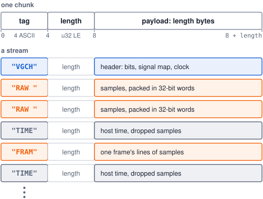

# The vgacap stream format

**You want the exact bytes of a vgacap stream: its header, every chunk type, every flag and every rule a reader applies.**

The C writer and reader are [`src/stream/writer.c`](writer.c) and [`src/stream/reader.c`](reader.c), declared in [`include/vgacap/stream.h`](../../include/vgacap/stream.h); [`python/vgacap/stream.py`](../../python/vgacap/stream.py) reads and writes the same bytes. Why the format has this shape is on [The vgacap stream](explanation-stream.md). How a simulation trace cuts a version 2 stream into compressed blocks is on [the simulation trace format](../../docs/trace-format.md).

All integers are unsigned and little-endian. In the tables, Offset is the byte offset in the payload, Type the field's width, and Field what it holds.

<picture>
  <source media="(prefers-color-scheme: dark)" srcset="../../docs/diagrams/stream-chunks-dark.svg">
  
</picture>

## Chunk framing

| Offset | Type | Field |
|---|---|---|
| 0 | 4 ASCII bytes | tag |
| 4 | u32 | `length`: the payload's size in bytes, at most 16 MiB (16,777,216) |
| 8 | `length` bytes | payload |

- Chunks follow each other with no padding and no sync word.
- The first chunk is `VGCH`. A later `VGCH` starts the stream again: the sample index goes back to 0.
- A tag of four printable ASCII bytes that the reader does not know is skipped by its length.
- Tags end in a space where the name is three letters: `RAW ` and `RLE `.

## Chunk types

| Tag | Version | Holds |
|---|---|---|
| `VGCH` | 1 and 2 | the header |
| `RAW ` | 1 and 2 | samples packed into 32-bit words |
| `RLE ` | 1 only | (value, run) pairs, 32 bits each |
| `FRAM` | 1 and 2 | a frame, or a window of lines, packed as `RAW ` |
| `EVNT` | 1 and 2 | sample values at increasing clocks |
| `TIME` | 1 and 2 | host time, a clock rate, dropped samples and a message |
| `RUNS` | 2 only | (value, run) pairs, the run in LEB128 |
| `BLKH` | 2 only | the sample index of the next sample |
| `META` | 2 only | `key=value` text |

## VGCH: the header

| Offset | Type | Field |
|---|---|---|
| 0 | u16 | `version`: 1 or 2 |
| 2 | u8 | `sample_bits`: 8, 12, 16 or 32 in version 1; 1 to 64 in version 2 |
| 3 | u8 | `mode` |
| 4 | u32 | `clock_hz`: the project clock in Hz; 0 is unknown |
| 8 | u8[8] | `signal_map`: the sample bit of hsync, vsync, r1, r0, g1, g0, b1, b0; `0xFF` is absent |
| 16 | u8 | `samples_per_word`: 1, 2, 4 or 8, with `samples_per_word * sample_bits` at most 32; version 2 with `sample_bits` over 32: 0 |
| 17 | u8 | `flags` |
| 18 | u16 | `desc_len`: at most 255 in version 1, 251 in version 2 |
| 20 | u8 | version 2 only: `samples_per_clock`, 1, or 2 exactly when there is a clock bit |
| 21 | u8 | version 2 only: `clock_bit`, 0 to `sample_bits` - 1, or `0xFF` for none |
| 22 | u8 | version 2 only: `clock_first`, the clock bit in sample 0, 0 or 1; 0 with no clock bit |
| 23 | u8 | version 2 only: reserved, 0 |
| 20 or 24 | `desc_len` bytes | `desc`: free text, UTF-8 |

- The chunk's length is exactly 20 + `desc_len` in version 1 and 24 + `desc_len` in version 2.
- A version 1 header reads as `samples_per_clock` 1, no clock bit, `clock_first` 0.
- Any other `version` is an error, and the reader stops.

### mode

| Value | Name | Meaning |
|---|---|---|
| 0 | extclk | sampled on the project's own clock edge |
| 1 | selfclk | the capture hardware made the clock |
| 2 | event | change events from a simulator or analyser |
| 3 | unknown | not stated |

### flags

| Bit | Name | Meaning when set |
|---|---|---|
| 0 | `FIRST_SAMPLE_MSB` | a word's first sample is in its most significant slot |
| 1 to 7 | -- | written as 0 |

### Signal maps in use

| Map | Wiring |
|---|---|
| `7, 3, 0, 4, 1, 5, 2, 6` | the [Tiny VGA Pmod](https://github.com/mole99/tiny-vga) on `uo_out[7:0]`, bit 0 = `uo_out[0]` |
| `11, 3, 0, 8, 1, 9, 2, 10` | a 12-bit read from GPIO 5 on an RP2040 demo board |

## RAW: packed samples

| Offset | Type | Field |
|---|---|---|
| 0 | u32 | `sample_count` |
| 4 | u32 words | ceil(`sample_count` / `samples_per_word`) words |

- Sample i is in word i / `samples_per_word`, slot i % `samples_per_word`, shifted left by slot × `sample_bits`.
- With `FIRST_SAMPLE_MSB` the slot is `samples_per_word` - 1 - (i % `samples_per_word`).
- The word count must match the chunk's length exactly.

## RLE: 32-bit runs

| Offset | Type | Field |
|---|---|---|
| 0 | u32 | `pair_count` |
| 4 | (u32, u32) pairs | `value`, then `run`: `run` samples of `value` |

The chunk's length is exactly 4 + 8 × `pair_count`.

## FRAM: a frame or a window

| Offset | Type | Field |
|---|---|---|
| 0 | u32 | `frame_counter` |
| 4 | u16 | `first_line`: the frame line the samples start on |
| 6 | u16 | `line_count` |
| 8 | u32 | `clocks_per_line` |
| 12 | u32 | `sample_count` |
| 16 | u32 words | the samples, packed as in `RAW ` |

- The samples start at the leading edge of the hsync pulse of `first_line`.
- Line 0 is the first line of the vsync pulse.
- Chunks with the same `frame_counter` are windows of one frame.

## EVNT: change events

| Offset | Type | Field |
|---|---|---|
| 0 | u32 | `event_count` |
| 4 | (u64, u32) events | `clock`, then `value` |

- Clocks strictly increase.
- Each value holds until the next event's clock; the last holds for one clock.

## TIME: time and losses

| Offset | Type | Field |
|---|---|---|
| 0 | u64 | `host_time_ns` |
| 8 | u32 | `clock_hz`: the clock rate as measured or set at this point |
| 12 | u32 | `dropped_samples`: the stream's total so far, never an increment |
| 16 | u16 | `msg_len`: at most 255, and exactly the chunk's length - 18 |
| 18 | `msg_len` bytes | `msg` |

- A rise in `dropped_samples`, or `msg` `overrun`, marks an overrun: the samples before it do not continue into those after.
- A reader takes the last `dropped_samples`, never a sum.

## RUNS: LEB128 runs (version 2)

| Offset | Type | Field |
|---|---|---|
| 0 | u32 | `pair_count`: at least 1 |
| 4 | pairs | `value`, then `run` |

- `value` is ceil(`sample_bits` / 8) bytes, little-endian, with the clock bit stored as 0 and no bit set at or above `sample_bits`.
- `run` is unsigned LEB128: 1 to 10 bytes, 7 bits a byte, least significant first, the top bit set when a byte follows.
- `run` is at least 1, minimally encoded, and below 2^64; a 10th byte is at most `0x01`.
- Two adjacent pairs of one chunk never share a value.
- The chunk's length is exactly 4 plus its pairs' bytes.

## BLKH: block header (version 2)

| Offset | Type | Field |
|---|---|---|
| 0 | u64 | `first_sample`: the index of the next sample |

- The length is exactly 8.
- A `first_sample` that is not the running index is reported, then adopted.

## META: metadata (version 2)

- 1 to 4096 bytes of strict UTF-8: `key=value` lines, each ending in `\n`, the last too.
- A key matches `[a-z][a-z0-9_]*` and appears once.
- The first line is `meta=open` or `meta=close`.
- The keys each kind requires, and their values, are on [the simulation trace format](../../docs/trace-format.md#meta).

## The sample index and the clock bit

| Item | Rule |
|---|---|
| Sample index n | 0 after a `VGCH`; grows by every sample delivered; set by every `BLKH` |
| Clock bit of sample n | `clock_first` XOR (n AND 1), never stored |
| Samples a clock | `samples_per_clock`: 2 with a clock bit, one low and one high |
| Time of sample n | round(n × 10^12 / (`samples_per_clock` × `clock_hz`)) ps, halves rounded up |

## Chunks a version 2 header allows

| Header | Allowed | Skipped and reported |
|---|---|---|
| version 1 | every version 1 chunk | `RUNS`, `BLKH`, `META` |
| version 2 with a clock bit | `RUNS`, `BLKH`, `META`, `TIME` | every other chunk |
| version 2, `sample_bits` over 32 | `RUNS`, `BLKH`, `META`, `TIME` | `RAW `, `FRAM`, `EVNT`, `RLE ` |
| version 2, 32 bits or fewer, no clock bit | all but `RLE ` | `RLE ` |

## What a reader does with a bad chunk

| Fault | What the C reader does | Event reported |
|---|---|---|
| a `version` other than 1 or 2 | stops reading | error `unsupported version` |
| a tag that is not printable, or a length over 16 MiB | scans byte by byte for the next known tag with a plausible length | resync, with the bytes skipped |
| a count that does not match the length (`RAW `, `RLE `, `FRAM`, `EVNT`, `TIME`) | scans for the next chunk | resync |
| a chunk before the first `VGCH` | scans for the next chunk | resync `chunk before header` |
| a bad `RUNS`, `BLKH` or `META`, or a chunk the header forbids | skips the chunk by its length | resync, with the whole chunk skipped |
| input that ends while scanning | stops | none: the caller reports it |

[`vgacap-dump`](../tools/reference-options.md#vgacap-dump) prints each resync as a `resync skipped=N reason=...` line. The Python reader raises `ValueError` with the same reason text instead of resynchronising.
